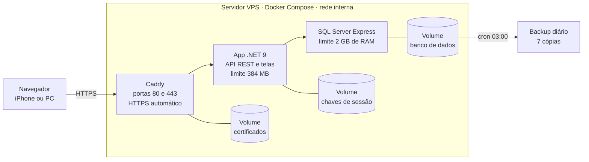

# Renata Doces – Documentação da solução

Atualizada em 16/11/2026.

## Visão geral

Renata Doces é um aplicativo web para gerenciar uma micro empresa de doces. Funciona no iPhone e no computador, direto no navegador, e pode ser instalado na tela inicial (PWA).

**Hoje o sistema cobre:** cadastro de clientes e de produtos, lançamento e cancelamento de pedidos com cálculo do total, códigos automáticos (`CLI-`, `PRD-`, `PED-`), login por usuário e senha e cadastro de novas contas com código de convite.

**Ainda não cobre** (previsto no escopo original): controle de compra de insumos, cadastro de receitas e relatórios de vendas.

Licença MIT.

## Arquitetura e tecnologias

O navegador fala apenas com o Caddy, que entrega o HTTPS e repassa as chamadas ao app; o app é o único que conversa com o SQL Server. O backup diário é feito por um script no servidor.

Só o Caddy é alcançável da internet. App e banco ficam em rede interna, sem porta publicada.

| Camada | Tecnologia | Observação |
| --- | --- | --- |
| Back-end | ASP.NET Core 9 (C#) | API REST e servidor do front-end |
| Banco | SQL Server, EF Core 9.0.2 | Migrations aplicadas ao iniciar; Express em produção, LocalDB em desenvolvimento |
| Front-end | HTML, CSS e JavaScript puros | PWA, sem framework |
| Autenticação | Cookie de sessão e `PasswordHasher` (PBKDF2) | Chaves de sessão em volume |
| Container | Docker, imagens oficiais da Microsoft | Build em duas etapas, usuário sem privilégios |
| HTTPS e proxy | Caddy 2 | Certificado Let's Encrypt automático |
| Integração contínua | GitHub Actions (`build.yml`) | Compila e valida o Dockerfile |

## Estrutura do repositório

| Pasta ou arquivo | Conteúdo |
| --- | --- |
| `Program.cs` | Configuração central: banco, login, limites de requisição, cabeçalhos de segurança, pipeline HTTP |
| `Controllers/` | `AuthController`, `ClientesController`, `ProdutosController`, `PedidosController` |
| `Models/` | Entidades: `Cliente`, `Produto`, `Pedido`, `PedidoItem`, `Usuario` |
| `DTOs/` | Dados aceitos e devolvidos pela API (evitam preenchimento indevido de campos) |
| `Data/` | `AppDbContext` e `BancoInicializacao` (aplica as migrations ao iniciar) |
| `Migrations/` | Histórico de alterações do banco (5 migrations) |
| `Security/` | `AuthOptions` (configuração de login) e `UsuarioInicial` (cria a conta inicial) |
| `Common/` | `Texto` (normalização) e `Codigos` (códigos automáticos) |
| `wwwroot/` | Front-end: `index.html`, `app.js`, `style.css`, manifesto PWA e ícones |
| `deploy/` | `Caddyfile`, `backup.sh` e o guia `LEIA-ME.md` |
| `.github/workflows/build.yml` | Compila o projeto e valida o Dockerfile a cada push e PR |
| `Dockerfile`, `docker-compose.yml`, `.env.example` | Container e implantação em servidor próprio |
| `Renata_Doces.http` | Requisições de exemplo para testar a API no Visual Studio |
| `README.md`, `SECRETS-SETUP.md` | Guia de uso e guia de segredos/deploy |

## Modelo de dados

Banco SQL Server, acessado com Entity Framework Core 9. Cinco tabelas:

| Tabela | Colunas principais | Relacionamentos |
| --- | --- | --- |
| `Clientes` | Id, Nome, Telefone, Email, Endereco | — |
| `Produtos` | Id, Codigo, Nome, Sabor, Recheio, Peso, PrecoVenda, Ingredientes | — |
| `Pedidos` | Id, ClienteId, DataPedido (UTC), ValorTotal | N:1 com Clientes (Restrict) |
| `PedidoItens` | Id, PedidoId, ProdutoId, Quantidade, PrecoUnitario | N:1 com Pedidos (cascata), N:1 com Produtos (Restrict) |
| `Usuarios` | Id, NomeUsuario (único, até 60), SenhaHash, CriadoEm | — |

**Regras de integridade**

- Cliente com pedidos e produto já vendido não podem ser excluídos (o banco recusa e a API responde 409).
- Cancelar um pedido apaga seus itens junto.
- O preço do produto é copiado para o item no momento da venda (`PrecoUnitario`), então mudar o preço depois não altera pedidos antigos.
- Valores monetários usam `decimal(18,2)`.

**Migrations:** `CriacaoInicialComPrecisao`, `AdicionarTabelaClientes`, `AdicionarTabelasDePedidos`, `AdicionarUsuarios` e `ProtegerHistoricoDePedidos`. São aplicadas automaticamente ao iniciar (`Database:MigrateOnStartup`), com novas tentativas enquanto o SQL Server termina de subir no Docker. O Designer de cada migration deve ser igual ao snapshot, senão o `Migrate()` falha.

**Códigos automáticos.** `CLI-0001`, `PRD-0001` e `PED-0001` vêm do número sequencial (Id) do banco, sem coluna nova (exceto `Produtos.Codigo`, que já existia). Antes de salvar, a tela mostra o código **previsto** (`GET /api/<recurso>/proximo-codigo`); o definitivo é o devolvido ao salvar. Produtos antigos mantêm o código que já tinham.

## API REST

Todas as rotas ficam sob `/api` e exigem login, exceto as marcadas como públicas. Erros vêm em JSON com `mensagem` em português (validação: 400; não encontrado: 404; conflito: 409).

| Rota | Métodos | Regras |
| --- | --- | --- |
| `/api/clientes` | GET, POST; GET, PUT, DELETE em `/{id}` | Nome obrigatório (2 a 120). Excluir cliente com pedidos: 409. Resposta traz `codigo` |
| `/api/clientes/proximo-codigo` | GET | Código previsto do próximo cliente |
| `/api/produtos` | GET, POST; GET, PUT, DELETE em `/{id}` | Preço de 0,01 a 999.999,99. Código gerado pelo sistema. Excluir produto vendido: 409 |
| `/api/produtos/proximo-codigo` | GET | Código previsto do próximo produto |
| `/api/pedidos` | GET (`?limite=`, até 500), POST; GET e DELETE em `/{id}` | Pelo menos 1 item. O preço do produto é congelado no item. Datas em UTC. Não há edição: cancela-se e lança-se de novo |
| `/api/pedidos/proximo-codigo` | GET | Código previsto do próximo pedido |
| `/api/auth/login` | POST, pública | Limite de 5 tentativas por minuto por IP |
| `/api/auth/registrar` | POST, pública | Limite de 5 por 10 minutos por IP. Regras na próxima seção |
| `/api/auth/cadastro` | GET, pública | Informa se o cadastro está aberto e se exige código |
| `/api/auth/logout`, `/api/auth/me` | POST, GET | Encerra a sessão; informa o usuário atual |
| `/health` | GET, pública | Verifica o app e a conexão com o banco |

O arquivo `Renata_Doces.http` traz exemplos prontos de cada chamada. A documentação OpenAPI só é exposta em desenvolvimento.

## Autenticação, cadastro e segurança

**Login.** Usuário e senha conferidos no banco. A senha é guardada só como hash (`PasswordHasher`, PBKDF2) e regravada se o algoritmo evoluir. Mesmo com usuário inexistente o sistema calcula um hash falso, para o tempo de resposta não revelar quais usuários existem. A sessão usa cookie `HttpOnly` e `SameSite=Lax`; `Secure` quando a conexão é HTTPS (ou sempre, com `Auth__CookieSempreSeguro=true`).

**Cadastro de contas.**

1. A primeira conta é livre (uma trava impede duas contas simultâneas no primeiro acesso).
2. Depois disso, criar conta exige o código de convite (`Auth__CodigoConvite`, comparado em tempo constante) ou estar logado.
3. Sem código configurado, o cadastro fica fechado após a primeira conta.
4. Usuário de 3 a 60 caracteres (letras, números e `. _ @ -`); senha de 10 a 128 caracteres, com confirmação.
5. Opcionalmente `Auth__Usuario` e `Auth__Senha` criam uma conta inicial; a senha não é refeita nas próximas inicializações.

**Proteções da aplicação**

| Proteção | Como |
| --- | --- |
| Acesso | Política global exige login; só login, logout, cadastro, `/health` e o front-end são públicos |
| Excesso de requisições | Login 5/min e cadastro 5/10 min por IP; limite geral de 300/min por IP |
| Cabeçalhos | CSP restritiva (`default-src 'self'`, sem scripts inline), `nosniff`, `Referrer-Policy: no-referrer`, `frame-ancestors 'none'`, HSTS em produção |
| Entrada de dados | DTOs com validação e tamanhos máximos; corpo de requisição limitado a 64 KB |
| Banco | Consultas parametrizadas pelo EF Core; FKs Restrict protegem o histórico |
| Saída no navegador | O front-end não usa `innerHTML`: textos entram como texto, o que barra XSS |
| Erros | Respostas padronizadas (ProblemDetails), sem detalhes internos; sem cabeçalho `Server` |

**Atenção ao IP.** O app confia no IP informado pelo proxy (`X-Forwarded-For`). No compose isso é seguro, pois só o Caddy alcança o app. Se o container for exposto direto na internet, o limite de tentativas pode ser burlado.

## Front-end

Aplicação de uma página em HTML, CSS e JavaScript puros (sem framework), servida pelo próprio app. Abas: Clientes, Produtos e Pedidos, mais as telas de login e de cadastro.

**iPhone e PWA**

- Manifesto e ícones (`apple-touch-icon`), para instalar na tela inicial.
- Respeita as áreas seguras do aparelho (entalhe e barra inferior).
- Campos com 16 px, para o iOS não dar zoom ao focar; alvos de toque de pelo menos 44 px.
- Ajusta o layout quando o teclado abre (`visualViewport`).
- Datas vêm em UTC e são convertidas para o horário local do aparelho.

**Comportamento**

- Formulários em folhas deslizantes (cliente e produto) e formulário de pedido com itens dinâmicos e total em tempo real.
- Busca por nome, código e telefone nas listas.
- Os três campos de código são somente leitura.
- Um contador de sessão descarta respostas atrasadas depois do logout, e os dados da tela são limpos ao sair.
- Confirmação antes de excluir ou cancelar.

## Configuração e variáveis de ambiente

Nada secreto fica no código. Em produção use variáveis de ambiente (`__` no lugar de `:`); no Visual Studio, use "Manage User Secrets".

**Lidas pelo app**

| Variável | Obrigatória | Função |
| --- | --- | --- |
| `ConnectionStrings__DefaultConnection` | Sim | Conexão com o SQL Server. O app não inicia sem ela |
| `Auth__Usuario` e `Auth__Senha` | Recomendada | Conta inicial (informe as duas ou nenhuma). Senha com no mínimo 10 caracteres |
| `Auth__CodigoConvite` | Recomendada | Código (mínimo 10 caracteres) exigido para criar novas contas |
| `Auth__CookieSempreSeguro` | Opcional | `true` força o cookie Secure quando há HTTPS de ponta a ponta |
| `DataProtection__KeysPath` | Opcional | Pasta persistente das chaves de sessão |
| `Database__MigrateOnStartup` | Opcional | `false` não aplica migrations ao iniciar (padrão: aplica) |
| `Hospedagem__ConfiarEmProxy` | Opcional | Confia no IP/esquema informados pelo proxy. Padrão: sim fora do IIS, não no IIS |
| `Hospedagem__ForcarHttps` | Opcional | `true` redireciona http para https |
| `PORT` | Opcional | Porta HTTP do container (padrão 8080) |
| `ASPNETCORE_ENVIRONMENT` | Opcional | `Development` ou `Production` |

**Lidas pelo `docker-compose.yml`** (arquivo `.env`, modelo em `.env.example`): `DOMAIN` (domínio do site), `SA_PASSWORD` (senha do SQL Server), `AUTH_USUARIO`, `AUTH_SENHA` e `AUTH_CODIGO_CONVITE`. O compose os repassa ao app com os nomes acima. Evite `; = " ' $` e espaços nos valores.

O `appsettings.Development.json` guarda só a conexão com o LocalDB do computador de desenvolvimento, sem senha.

## Execução local, Docker e VPS

**No Visual Studio.** Abra `Renata_Doces.sln` e rode (▶). Em desenvolvimento o app usa o LocalDB e aplica as migrations sozinho; abre em `https://localhost:7260` (ou `http://localhost:5167`). Na primeira vez, o Visual Studio pede para confiar no certificado de desenvolvimento do ASP.NET Core; pode aceitar.

**Com Docker (teste ou produção simples).** O `Dockerfile` usa duas etapas (SDK para compilar, runtime para executar), roda sem privilégios e respeita `PORT`. O `README.md` traz os comandos `docker run` do SQL Server e do app numa rede Docker.

**Em VPS (Turbo Cloud ou similar).** O `docker-compose.yml` sobe Caddy, app e SQL Server, com limites de memória (SQL Server 2 GB, app 384 MB, Caddy 96 MB), rotação de logs, sem arquivos de falha e app com sistema de arquivos somente leitura. Passos resumidos (detalhes em [`deploy/LEIA-ME.md`](../deploy/LEIA-ME.md)):

1. Apontar um domínio para o IP do servidor.
2. Preparar o servidor: atualizações automáticas, firewall liberando 22, 80 e 443, SSH só com chave, Docker.
3. `git clone` em `/opt/renata-doces`, `cp .env.example .env`, `chmod 600 .env` e preencher os valores.
4. `docker compose up -d --build`; conferir `docker compose ps` (o `sql` deve ficar `healthy`).
5. Agendar `deploy/backup.sh` no cron.

O compose recusa subir se `SA_PASSWORD`, `AUTH_USUARIO`, `AUTH_SENHA` ou `AUTH_CODIGO_CONVITE` estiverem vazios, para o site nunca ir ao ar com o cadastro aberto ao primeiro visitante.

**Em hospedagem IIS (MonsterASP.NET).** Sem Docker: o app roda dentro do IIS (modo InProcess), com o banco SQL Server do provedor, variáveis de ambiente no painel e chaves de sessão em `private/keys`. Passo a passo em [`deploy/MONSTERASP.md`](../deploy/MONSTERASP.md).

## Operação

| Tarefa | Como |
| --- | --- |
| Backup diário | `deploy/backup.sh` (cron, 03:00): modo SIMPLE, `.bak` compactado com checksum, os 7 últimos em `/opt/renata-backups`. Copie para fora do servidor com rclone ou scp |
| Restaurar | Copiar o `.bak` para `/var/opt/mssql/data/` do container `sql` e rodar `RESTORE DATABASE` com `sqlcmd` |
| Atualizar o sistema | `git pull origin main`, `docker compose up -d --build`, `docker image prune -f`. As migrations rodam sozinhas |
| Ver se está no ar | `docker compose ps`, `docker compose logs -f app` e `GET /health` |
| Memória e disco | `docker stats --no-stream`, `free -h`, `df -h /`, `docker system df` |
| Trocar uma senha de serviço | Editar o `.env` e rodar `docker compose up -d`. Trocar `AUTH_SENHA` não muda a senha de uma conta já criada |

**Problemas comuns**

- O Caddy não obtém certificado: confira o DNS e as portas 80 e 443.
- O `app` reinicia sem parar: veja `docker compose logs app` (senha do SQL, conta inicial mal formada ou permissão em `/keys`).
- Erro de sistema de arquivos somente leitura: remova `read_only: true` do serviço `app`.
- O `sql` não fica `healthy`: pouca RAM ou `SA_PASSWORD` fora da regra de complexidade.

## Qualidade, limitações e roadmap

**Como o projeto é verificado hoje**

- O workflow `build.yml` compila a solução e valida o Dockerfile a cada push e pull request, sem usar segredos.
- O front-end teve um teste automatizado de comportamento (35 verificações) durante o desenvolvimento, mantido fora do repositório.
- O back-end não tem projeto de testes automatizados.
- Revisões independentes do código (migrations, segurança e compilação) foram feitas por leitura. O código foi compilado e executado no Visual Studio pelo responsável.

**Limitações conhecidas**

- Implantação em VPS, backup e restauração ainda não foram exercitados num servidor real.
- Não há índice único em `Produto.Codigo`; produtos antigos podem ter códigos repetidos.
- O código mostrado antes de salvar é uma previsão; o definitivo vem na gravação.
- Pedidos não são editáveis (cancelar e lançar de novo).
- `KnownNetworks` do `ForwardedHeaders` fica obsoleto em .NET 10.
- Não há workflow de deploy automático, e a branch `main` não tem proteção.

**Próximos passos sugeridos**

1. Conferir o build verde no GitHub Actions e fazer o primeiro deploy em VPS.
2. Controle de insumos e compras.
3. Receitas, com custo por produto.
4. Relatórios de vendas.
5. Projeto de testes para o back-end e índice único em `Produto.Codigo`.
